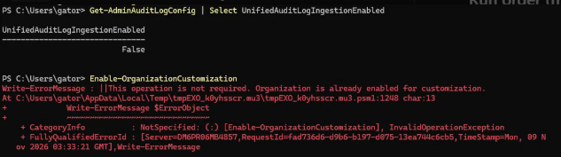
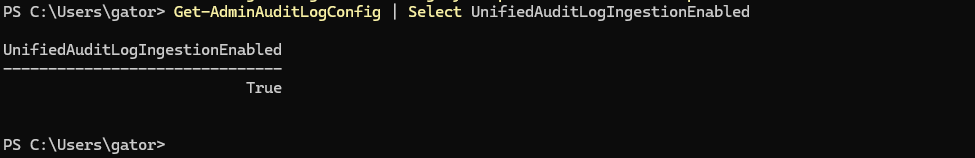

# microsoft-365-enterprise-admin-lab

Being able to administer Microsoft 365 environments is important since companies utilize Microsoft 365 for administrative and business purposes.

# Setup
Go to billing and go your products and start a free trial for the Microsoft E5 trial, then on the host computer run:    
Install-Module Microsoft.Graph, ExchangeOnlineManagement -Scope CurrentUser 
Connect-MgGraph -Scopes "User.ReadWrite.All","Group.ReadWrite.All","Directory.ReadWrite.All","RoleManagement.ReadWrite.Directory","Policy.ReadWrite.ConditionalAccess","IdentityRiskyUser.Read.All","AuditLog.Read.All"
Connect-ExchangeOnline -UserPrincipalName jontaylor@patchlab26.onmicrosoft.com  
Connect-ExchangeOnline -UserPrincipalName adm-yourname@yourdomain.com   

After getting connected, turn on logging:   
Set-AdminAuditLogConfig -UnifiedAuditLogIngestionEnabled $true and if this pops up: 
    
Then start by checking to see if a change is needed by running Get-AdminAuditLogConfig | Select UnifiedAuditLogIngestionEnabled and if it returns false run Enable-OrganizationCustimzation which will pop up with: 
  
Open up a new PowerShell and run:   
Disconnect-ExchangeOnline -Confirm:$false   
Connect-ExchangeOnline -UserPrincipalName adm-yourname@yourdomain.com   
Set-AdminAuditLogConfig -UnifiedAuditLogIngestionEnabled $true  
And the last command can take up to 60 minutes to complete or fast in this situation:   
  
Then run to get the license: Get-MgSubscribedSku | Select SkuPartNumber, ConsumedUnits, @{n='Total';e={$_.PrepaidUnits.Enabled}}    
And see this:   
    
Saying that the cause is PowerShell 5.1 since the current version is PowerShell 7.0. Update by running winget install --id Microsoft.PowerShell -e. Then verify with pwsh -v and switch to the latest with pwsh and to check the version with $PSVersionTable.PSVersion:    
    
Then re-install with Install-Module Microsoft.Graph, ExchangeOnlineManagement -Scope CurrentUser -Force 
