# microsoft-365-enterprise-admin-lab

Being able to administer Microsoft 365 environments is important since companies utilize Microsoft 365 for administrative and business purposes.

# Setup
Go to billing and go your products and start a free trial for the Microsoft E5 trial, then on the host computer run:    
Install-Module Microsoft.Graph, ExchangeOnlineManagement -Scope CurrentUser 
Connect-MgGraph -Scopes "User.ReadWrite.All","Group.ReadWrite.All","Directory.ReadWrite.All","RoleManagement.ReadWrite.Directory","Policy.ReadWrite.ConditionalAccess","IdentityRiskyUser.Read.All","AuditLog.Read.All"
Connect-ExchangeOnline -UserPrincipalName jontaylor@patchlab26.onmicrosoft.com  
Connect-ExchangeOnline -UserPrincipalName adm-yourname@yourdomain.com   

# Identity and Foundation

After getting connected, turn on logging:   
Set-AdminAuditLogConfig -UnifiedAuditLogIngestionEnabled $true and if this pops up: 
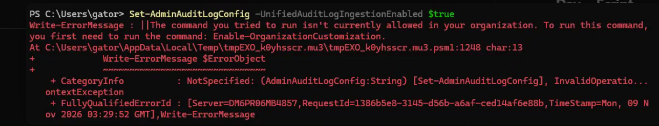    
Then start by checking to see if a change is needed by running Get-AdminAuditLogConfig | Select UnifiedAuditLogIngestionEnabled and if it returns false run Enable-OrganizationCustimzation which will pop up with: 
  
Open up a new PowerShell and run:   
Disconnect-ExchangeOnline -Confirm:$false   
Connect-ExchangeOnline -UserPrincipalName adm-yourname@yourdomain.com   
Set-AdminAuditLogConfig -UnifiedAuditLogIngestionEnabled $true  
And the last command can take up to 60 minutes to complete or fast in this situation:   
  
Then run to get the license: Get-MgSubscribedSku | Select SkuPartNumber, ConsumedUnits, @{n='Total';e={$_.PrepaidUnits.Enabled}}    
And see this:   
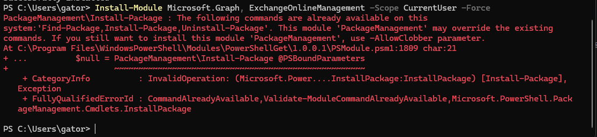      
Saying that the cause is PowerShell 5.1 since the current version is PowerShell 7.0. Update by running winget install --id Microsoft.PowerShell -e. Then verify with pwsh -v and switch to the latest with pwsh and to check the version with $PSVersionTable.PSVersion:    
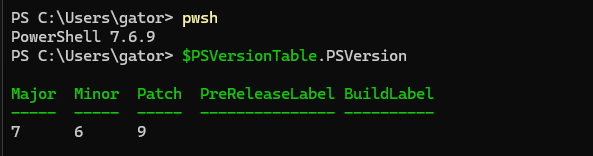    
Then re-install with Install-Module Microsoft.Graph, ExchangeOnlineManagement -Scope CurrentUser -Force 
And when this happens:  
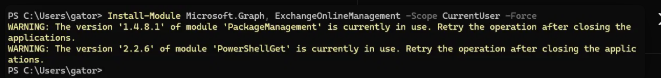
Check the PowerShell version by running $PSVersionTable.PSVersion.Major and run Get-InstalledModule Microsoft.Graph, ExchangeOnlineManagement | Select Name, Version. If it prints the current version number then its fine. For PowerShell if its 7, also good.    
Then cd into the folder on host computer and to allow downloaded scripts to run, type: Set-ExecutionPolicy -Scope CurrentUser -ExecutionPolicy RemoteSigned. Then run Get-ChildItem C:\Users\user\github name -Recurse -File | Unblock-File.    
Be good to add a few folders in the repo so run:    
mkdir scripts\common, scripts\identity, scripts\conditional-access, scripts\security, scripts\exchange, scripts\incident-response, data -Force
Then type Move-Item C:\Users\user\Downloads\LabCommon.psm1 scripts\common\  
*These scripts was made by Claude*    
Then run Import-Module .\scripts\common\LabCommon.psm1 -Force and import the script and if this occurs: 
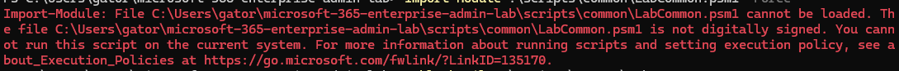  
The solution is to unblock the file by running: 
Unblock-File .\scripts\common\LabCommon.psm1 and checking the policy by running Get-ExecutionPolicy-List and see if CurrentUser says RemoteSigned or not. If not run Set-ExecutionPolicy -Scope CurrentUser -ExecutionPolicy RemoteSigned -Force.   
This time it will work so run: Connect-Lab -AdminUpn adm-yourname@yourdomain.com with the admin domain and wait a couple times for sign in prompts. 
Then check how many licenses are left with: Get-MgSubscribedSku | Select SkuPartNumber, ConsumedUnits, @{n='Total';e={$_.PrepaidUnits.Enabled}} and unlock the rest of the files with Get-ChildItem . - Recurse File | Unblock-File which should show.  
Then find the domain with for user addresses by typing Get-MgDomain | Select Id, IsDefault, IsVerified. 
Then run: .\scripts\identity\New-LabUsers.ps1 -Domain jon-maillab.org -CreateDepartmentGroups -WhatIf and watch the dry run go. 
Then run it live without -WhatIf:   
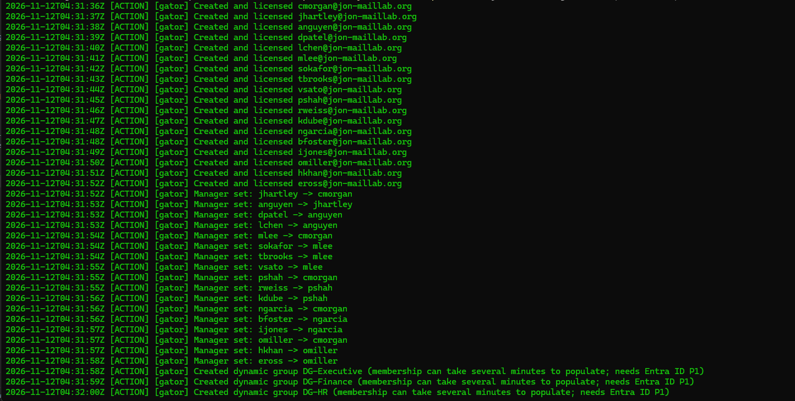    
The users and department groups have been created.  
And check Microsoft 365:    
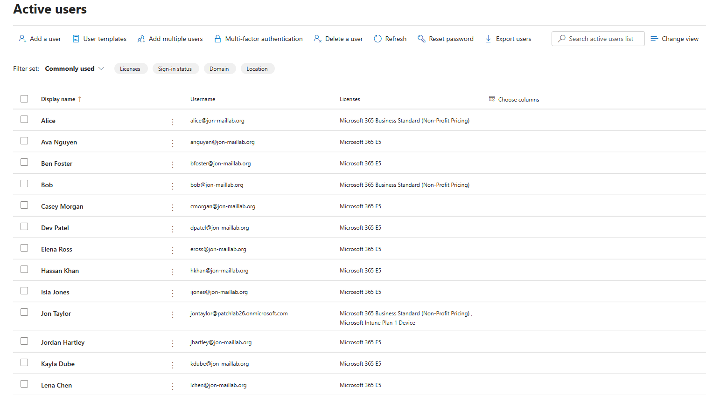    
And to fully verify run these from the screenshot:  
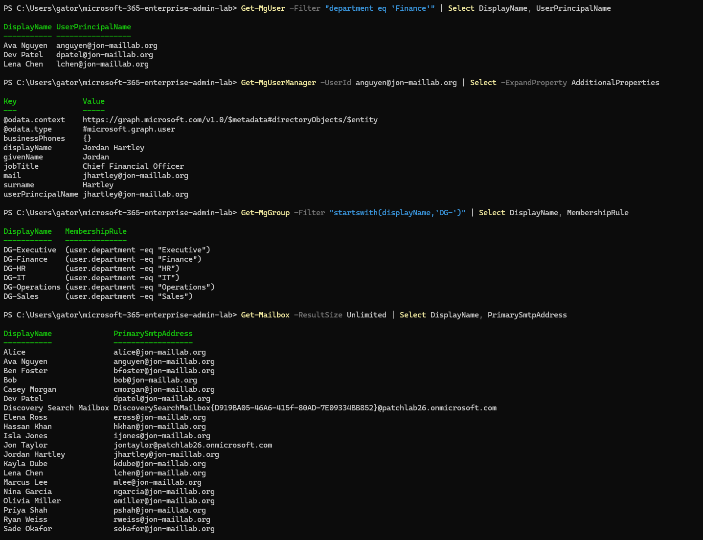  
Now since the users are created its time to do a leaver test on two users for a test run by running .\scripts\identity\Invoke-Leaver.ps1 -UserPrincipalName kdube@jon-maillab.org -WhatIf:  
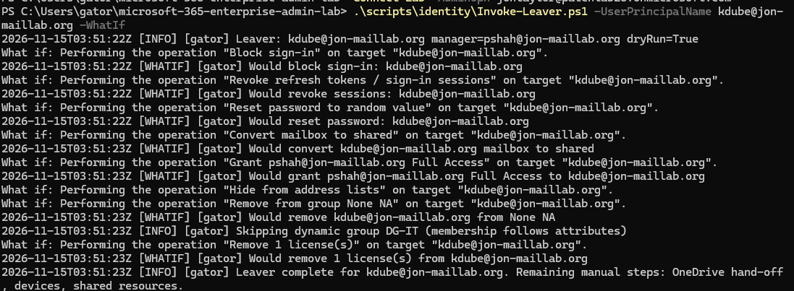    
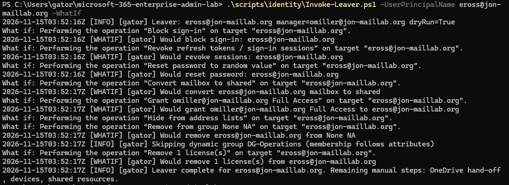    
This shows both the manager links for both users and the steps taken such as password reset, mailbox conversion, and more. Then run a live version next without -WhatIf.    
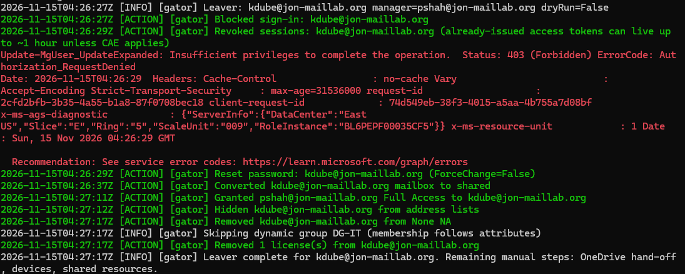  
Note the red means the password reset failed but everything else worked.    
*Downloaded a new LabCommon.psm1 from Claude*
Then delete the old one and put the new LabCommon.psm1 in there instead, then run Get-ChildItem . -Recurse -File | Unblock-File. Then close and open a new PowerShell script.   
In the new PowerShell script run:   
Set-ExecutionPolicy -Scope CurrentUser -ExecutionPolicy Bypass -Force   
Import-Module .\scripts\common\LabCommon.psm1 -Force    
$null = Reset-LabPassword -UserPrincipalName kdube@jon-maillab.org and should show  
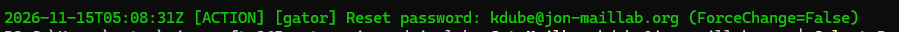  
Then verify by running these commands:  
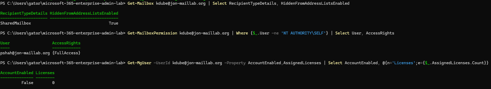  
Then check with ecross by running:  
.\scripts\identity\Invoke-Leaser.ps1 -UserPrincipalName eross@jon-maillab.org with no errors this time: 
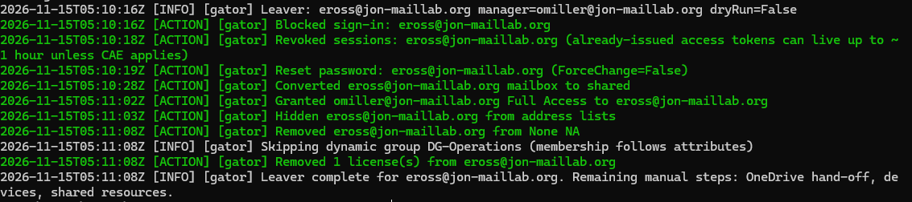    

# Access
First after adding Claude generated New-LabAccessModel.ps1 do a test run with .\scripts\groups\New-LabAccessModel.ps1 -Domain jon-maillab.org -CreateBreakGlass -BreakGlassDomain patchlab26.onmicrosoft.com -WhatIf to see if a test run works.    
And make sure to run: Connect-MgGraph -NoWelcome -Scopes User.ReadWrite.All,Group.ReadWrite.All,Directory.ReadWrite.All,RoleManagement.ReadWrite.Directory,Policy.ReadWrite.ConditionalAccess,Policy.Read.All,Application.Read.All,UserAuthenticationMethod.ReadWrite.All,IdentityRiskyUser.ReadWrite.All,AuditLog.Read.All,DelegatedPermissionGrant.ReadWrite.All,User-PasswordProfile.ReadWrite.All,AdministrativeUnit.ReadWrite.All,RoleEligibilitySchedule.ReadWrite.Directory just in case PowerShell was signed out of.   
After running:  
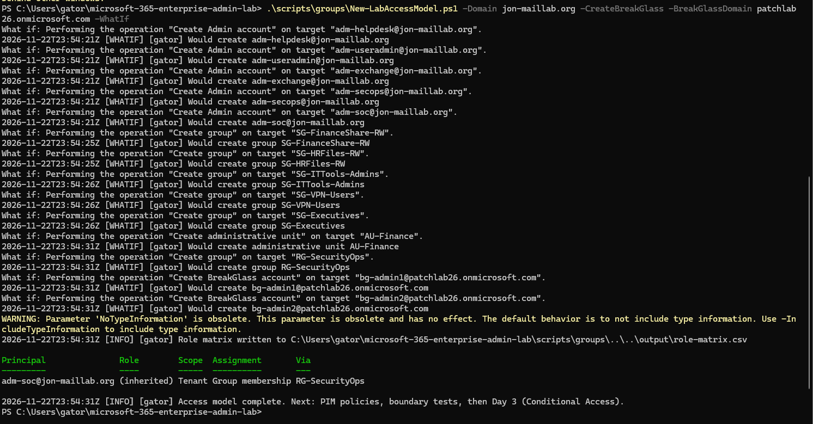    
Since it worked, run without -WhatIf.   
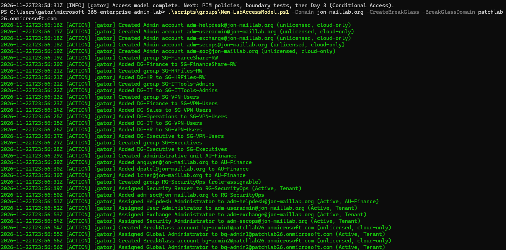    
Since 2 break glass accounts were created, sign in as one of them to confirm they work. 
After sigining as one:  
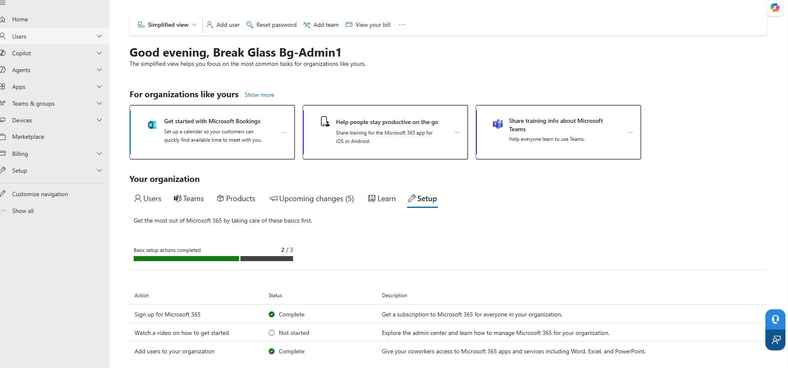  
Then run this command to assign licenses:   
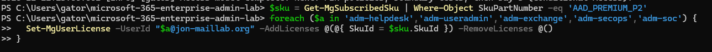    
After verifying that the script worked, verify it with: 
'adm-helpdesk','adm-useradmin','adm-exchange','adm-secops','adm-soc' | ForEach-Object {
  Get-MgUserLicenseDetail -UserId "$_@jon-maillab.org" | Select-Object @{n='User';e={$_}}, SkuPartNumber
}   
Its time to move on to Conditional access with a What-if Test run with: 
.\scripts\conditional-access\Deploy-ConditionalAccess.ps1 -BreakGlassUpn bg-admin1@patchlab26.onmicrosoft.com,bg-admin2@patchlab26.onmicrosoft.com -IncludeRiskPolicies -WhatIf:    
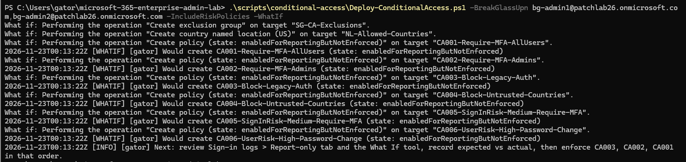  
Then live without -WhatIf.  
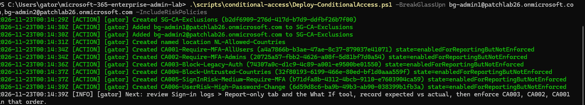  
Since its read only go to the Entra admin center -> Conditional Access -> Policies and they should be there:    
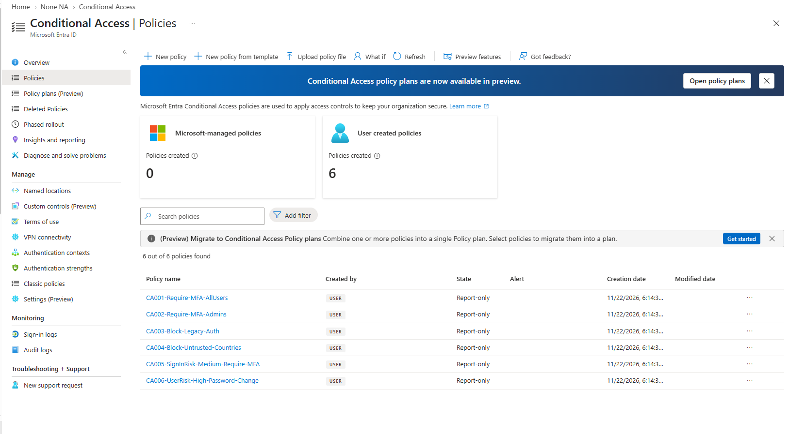  
Then click on CA001, click on edit or view and get here:    
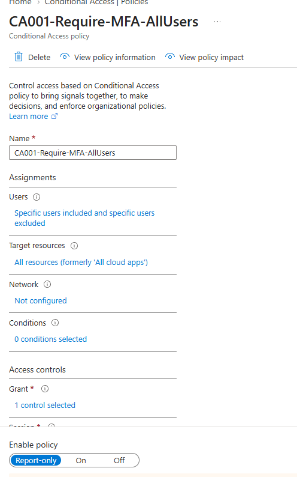  
Then click on users and set to specific and exclude SG-CA-Exclusions and save it.   
Then go check security defaults by going to Overview -> Properties -> scroll down and click on manage security defaults and change it to disabled from enabled with the reason being my organization is using conditional access.   
Then go to Authentication Methods and make sure that Microsoft Authenticator and Temporary Access Pass is enabled. With TAP enabled, temporary access pass codes can be sent out and used for different users run:  
foreach ($u in 'dpatel','mlee','pshah','anguyen','adm-secops','adm-helpdesk') {
  $tap = New-MgUserAuthenticationTemporaryAccessPassMethod -UserId "$u@jon-maillab.org" -BodyParameter @{ lifetimeInMinutes = 60; isUsableOnce = $false }
  [pscustomobject]@{ User = $u; TAP = $tap.TemporaryAccessPass }
}
Then sign as one of the users in a private window with their email and sign in with the TAP code to sign in and get here:   
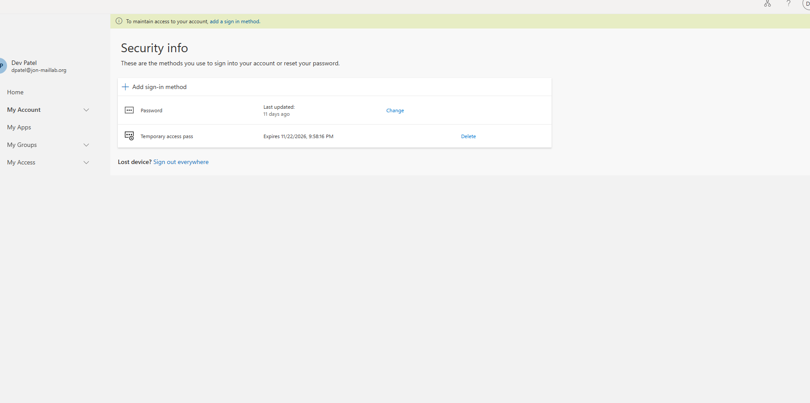  
Then go to outlook.office.com and teams.microsoft.com to verify:    
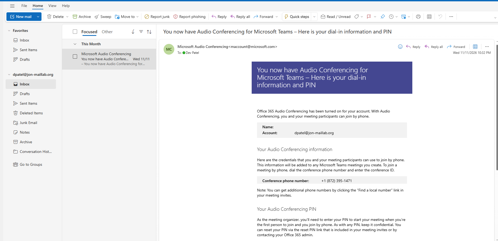    
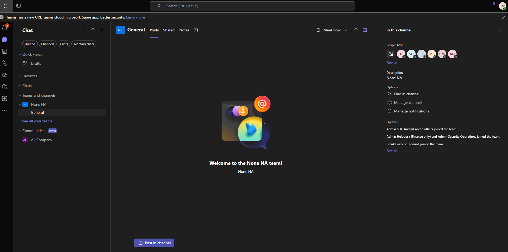    
And through checking sign in logs through Monitoring & Health:  
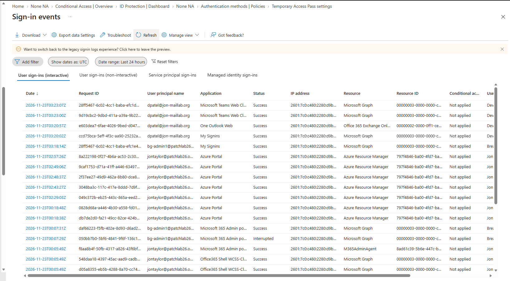  
And through read only view: 
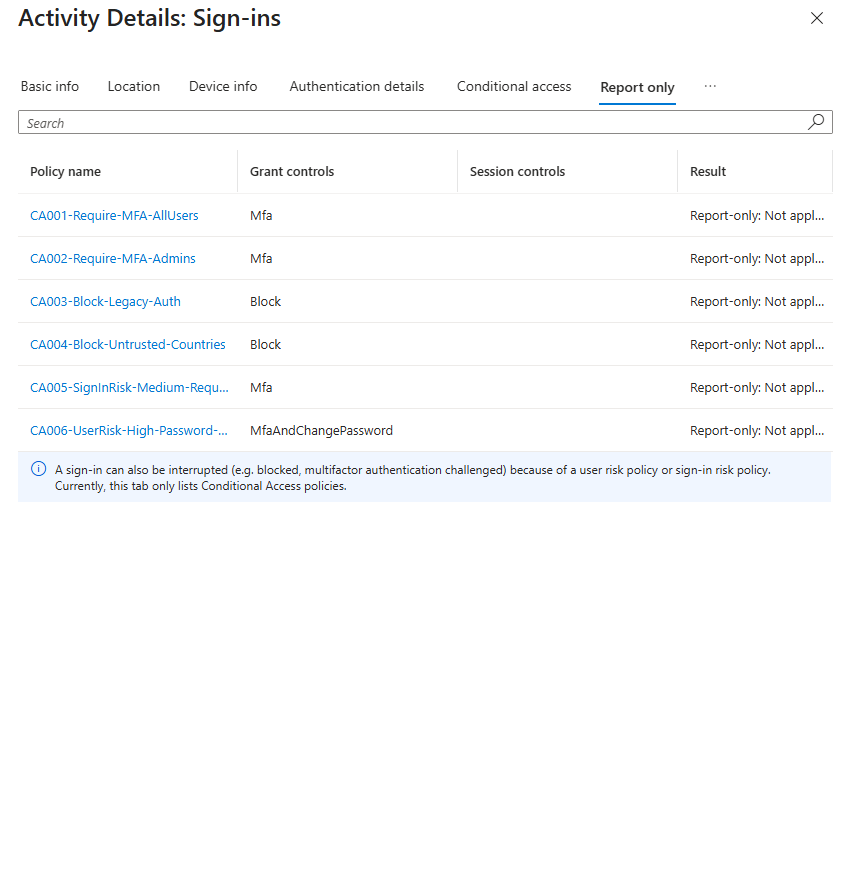  
And from checking the admin sign in from earlier:   
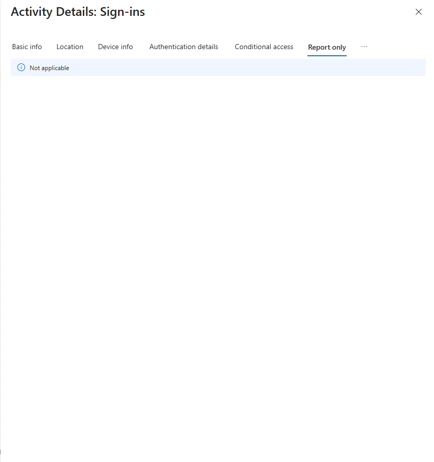    
Which shows not applicable since its a break glass account. 
And when checking the second admin account: 
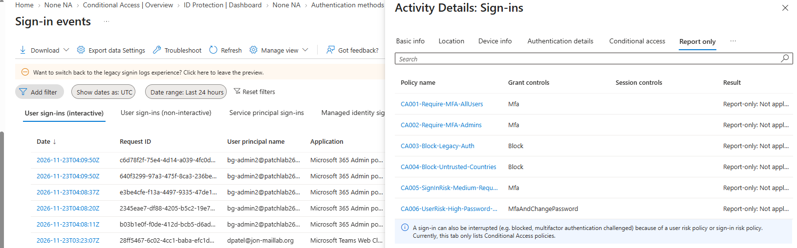  
Then sign in with TAP as one of the adm accounts and reach here:    
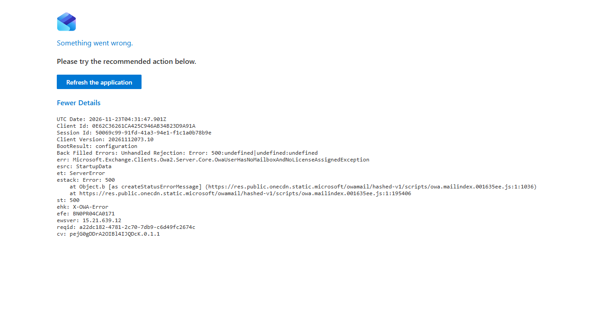   
Then sign as another adm account, such as adm-secops since last was adm-helpdesk and reach the same error message as before since the script created them without licenses. Then go check the logs: 
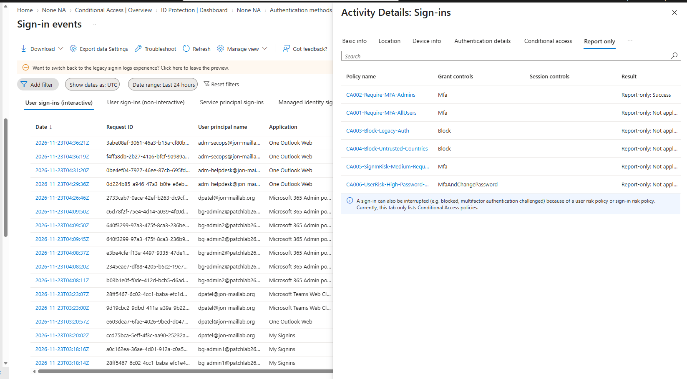    
With CA001 it shows not applied for all users since its a regular member, lets check one of adm-helpdesk's logs:    
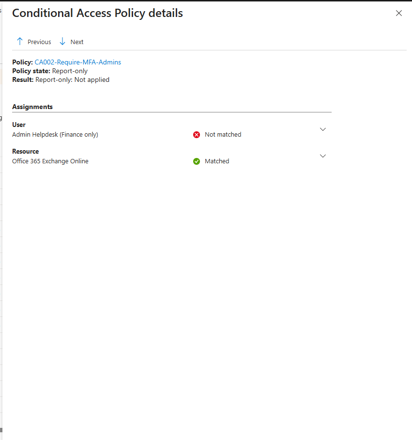    
From looking over this, adm-helpdesk is not covered by CA002 with the cause being the role doesn't pick up admin assignments, so run this:  
# 1. Group of all admin accounts
$g = New-MgGroup -DisplayName 'SG-Admin-Accounts' -Description 'All admin accounts (CA002 targets this in addition to roles)' -MailEnabled:$false -MailNickname 'sgadminaccounts' -SecurityEnabled:$true -GroupTypes @()
foreach ($a in 'adm-helpdesk','adm-useradmin','adm-exchange','adm-secops','adm-soc') {
  $u = Get-MgUser -Filter "userPrincipalName eq '$a@jon-maillab.org'"
  New-MgGroupMember -GroupId $g.Id -DirectoryObjectId $u.Id
}

# 2. Add the group to CA002, keeping the roles and the exclusion
$p = Get-MgIdentityConditionalAccessPolicy -All | Where-Object DisplayName -eq 'CA002-Require-MFA-Admins'
$users = @{
  includeRoles  = @($p.Conditions.Users.IncludeRoles)
  includeGroups = @($g.Id)
  excludeGroups = @($p.Conditions.Users.ExcludeGroups)
}
Update-MgIdentityConditionalAccessPolicy -ConditionalAccessPolicyId $p.Id -BodyParameter @{ conditions = @{ users = $users } }  
Then issue a new TAP for adm-helpdesk by running: 
foreach ($u in 'dpatel','mlee','pshah','anguyen','adm-secops','adm-helpdesk') {
  $tap = New-MgUserAuthenticationTemporaryAccessPassMethod -UserId "$u@jon-maillab.org" -BodyParameter @{ lifetimeInMinutes = 60; isUsableOnce = $false }
  [pscustomobject]@{ User = $u; TAP = $tap.TemporaryAccessPass }
} 
And sign in on entra.microsoft.com and then go check the logs:  
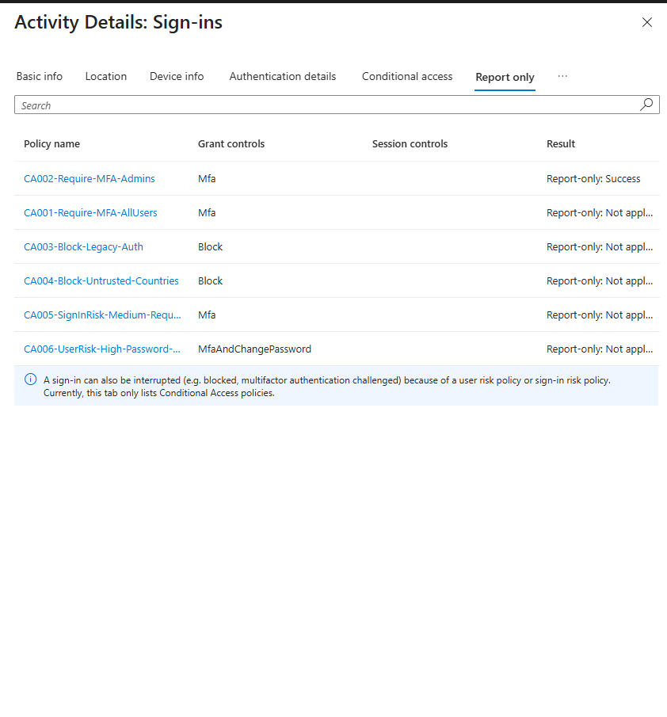  
Since it still isn't working check the policy stuff by running: 
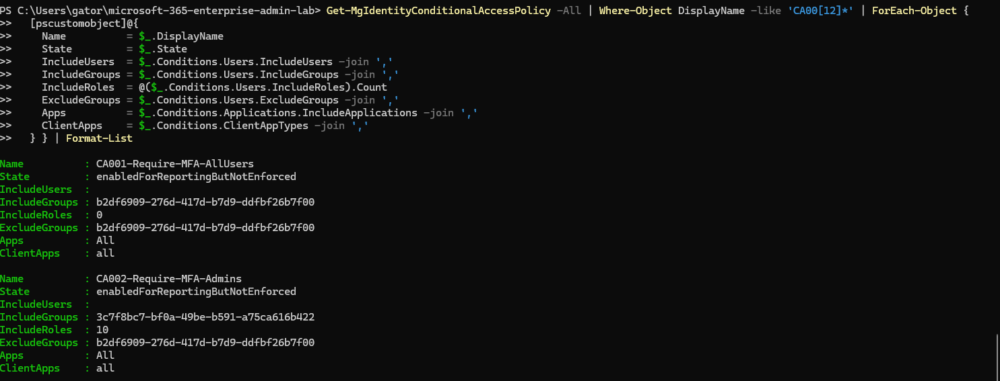 
The dump shows the IncludeUsers as empty, fix CA001 by running: 
$p = Get-MgIdentityConditionalAccessPolicy -All | Where-Object DisplayName -eq 'CA001-Require-MFA-AllUsers'
Update-MgIdentityConditionalAccessPolicy -ConditionalAccessPolicyId $p.Id -BodyParameter @{
  conditions = @{ users = @{ includeUsers = @('All'); includeGroups = @(); excludeGroups = @('b2df6909-276d-417d-b7b9-ddfbf26b7f00') } }
} 
And check the other policies too: 
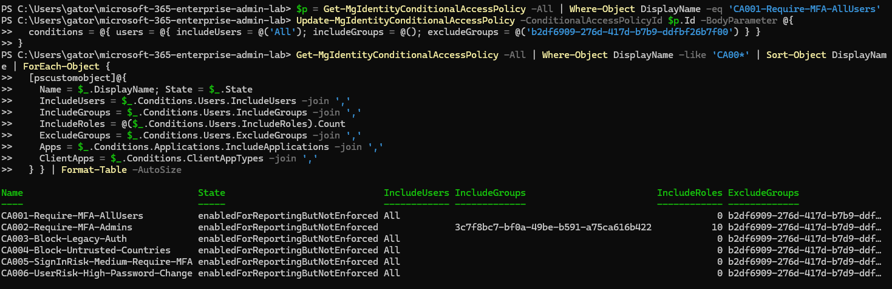  
Fix it by running:  
$excl = (Get-MgGroup -Filter "displayName eq 'SG-CA-Exclusions'").Id
$p = Get-MgIdentityConditionalAccessPolicy -All | Where-Object DisplayName -eq 'CA001-Require-MFA-AllUsers'
Update-MgIdentityConditionalAccessPolicy -ConditionalAccessPolicyId $p.Id -BodyParameter @{
  conditions = @{ users = @{ includeUsers = @('All'); includeGroups = @(); excludeGroups = @($excl) } }
} 
And verifying from here:  
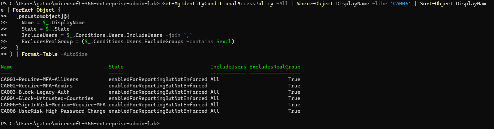  
With that all are now correct